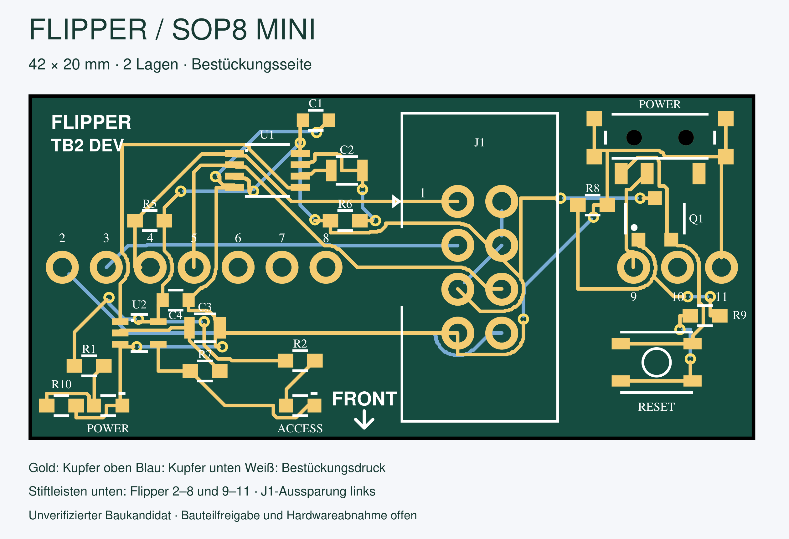
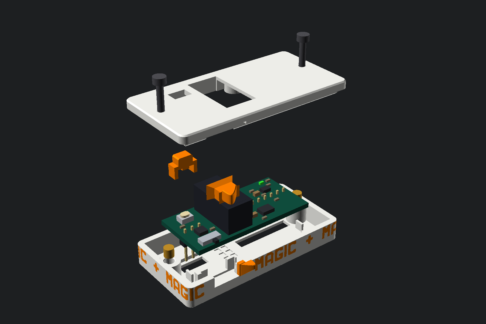

# Flipper TB2 Dev Board

A compact **3.3 V SPI adapter for Flipper Zero** that connects an SOP8 clip cable to the flash chip of a Toniebox 2. The 42 x 20 mm board provides a POWER switch, a RESET button, and separate POWER and ACCESS indicators.

**Hardware Rev. 1.0 - unverified build candidate.** The manufacturing files have passed supplier review and were released for production, but the finished mini-board has not yet completed physical validation. Reset by interrupting the target supply was tested on the preceding setup and accepted for this use case.

## Manufacture or modify the board

- **[Release v1.0.1 with PCBWay files](/Netfreak25/TB2-Dev-Board/releases/tag/v1.0.1)**
- **[PCBWay ordering guide](docs/pcbway-ordering.md)** with configuration, upload mapping, and assembly notes.
- **[Editable Fritzing design](hardware/TB2-Dev-Board-Rev1.0.fzz)** and [editing notes](docs/editing.md).
- **[3D-printable enclosure](enclosure/README.md)** with a slicer project, individual STL models, and an OpenSCAD entry point.
- [Pin mapping and operation](docs/hardware.md), [assembly drawing](docs/Assembly.pdf), and [mechanical requirements](docs/Mechanical-requirements.pdf).

## Board functions

| Function | Implementation |
|---|---|
| Flipper connection | JZ1: GPIO pins 2-8; JZ2: GPIO pins 9-11; headers mounted on the bottom |
| Flash connection | J1: keyed 2x4 shrouded header, 2.54 mm pitch |
| POWER | S1 switches the external 3.3 V target supply |
| RESET | S2 controls Q1; the external target supply remains disconnected while pressed |
| POWER indicator | D1, green, indicates target power |
| ACCESS indicator | D2, red, blinks during sustained access activity |
| Orientation | FRONT arrow on top; the rear QR code contains the text `Netfreak` |

The board requires no firmware of its own. A compatible SOP8 clip and cable and a Flipper Zero are not included in the bill of materials.

## Components

| Parts | Purpose or selection |
|---|---|
| Q1 - AO3401A | P-channel MOSFET for target-power interruption |
| S1 - Hroparts K3-1296S-E1 | Latching POWER slide switch |
| S2 - ALPS SKRPACE010 | Momentary RESET button |
| U1 - SN74LVC1G123DCTR | Extends short access pulses for the indicator circuit |
| U2 - SN74LVC1G132DCKR | Schmitt-trigger NAND used by the blinking ACCESS indicator |
| R5 - 10 kOhm | Pull-up from /CS to the switched target supply |
| R1/R2, D1/D2 | LED current limiting and status indication |
| R10 - 4.7 kOhm | Shunt across the POWER LED to suppress faint back-feed glow |
| Remaining R/C parts | Timing, gate control, and supply decoupling |
| JZ1/JZ2 - XFCN PZ254V | Flipper headers with 6.1 +/- 0.2 mm mating pins |

The [complete BOM](manufacturing/pcbway/BOM.csv) contains **22 physical components in 17 grouped positions**: 19 SMD parts and three THT connectors. PCBWay may select economical compliant parts for the resistor and capacitor positions marked for specification-based selection. Connectors, LEDs, timing capacitors, and fixed manufacturer parts remain subject to the qualification rules in the BOM.

## Compatible software

The active SPI mapping matches [SPI Mem Manager](https://lab.flipper.net/apps/spi_mem_manager): MOSI on pin 2, MISO on pin 3, /CS on pin 4, CLK on pin 5, and 3.3 V on pin 9.

[Core Flasher for Flipper Zero](https://github.com/Netfreak25/Core-Flasher-Flipper-App) uses the same hardware-SPI signal and supply pins and can expose the flash through its WebUSB/MPSSE bridge. Its wiring guide names Flipper pin 8 for GND; this PCB uses pin 11. Pins 8 and 11 are electrically common Flipper ground connections.

[TB2 Manager](https://github.com/Netfreak25/TB2-Manager) supports Toniebox management, including direct dump and flash operations. Its integrated Core Flasher mode also provides live flash access through Chrome and WebUSB. The PCB itself is not a USB device.

## Before connecting

Use the board only with compatible **3.3 V flash devices**. Disconnect the Toniebox battery and USB-C before attaching the clip. Verify Flipper orientation, clip pin 1, and the supply voltage; an incorrect connection can damage the flash chip. The shortened headers do not provide complete mechanical reverse-polarity protection.

RESET disconnects the external target supply while SPI and GND remain connected. It therefore does not prevent every possible back-feed path through the signal lines. ACCESS indicates bus activity, not a verified successful transfer.

## License

The hardware design and accompanying source material are licensed under the [CERN Open Hardware Licence Version 2 - Permissive](LICENSE).
